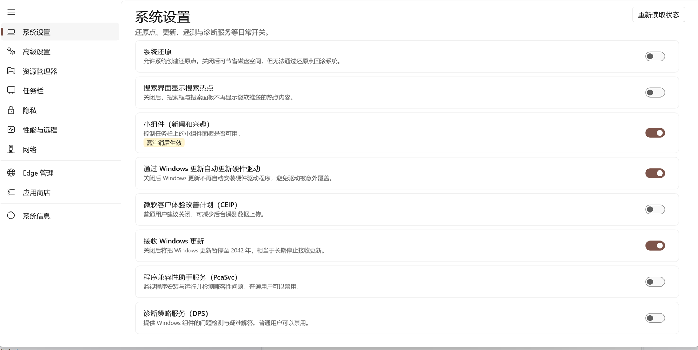
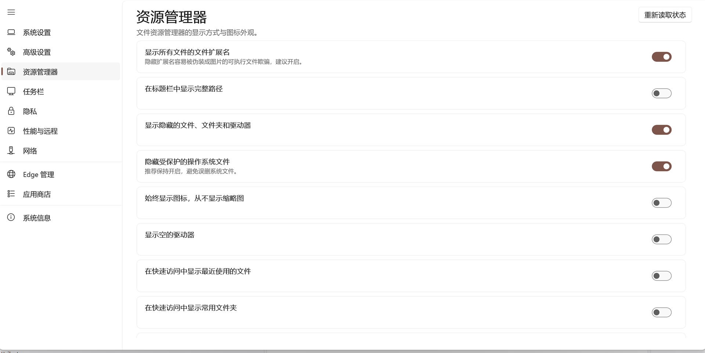
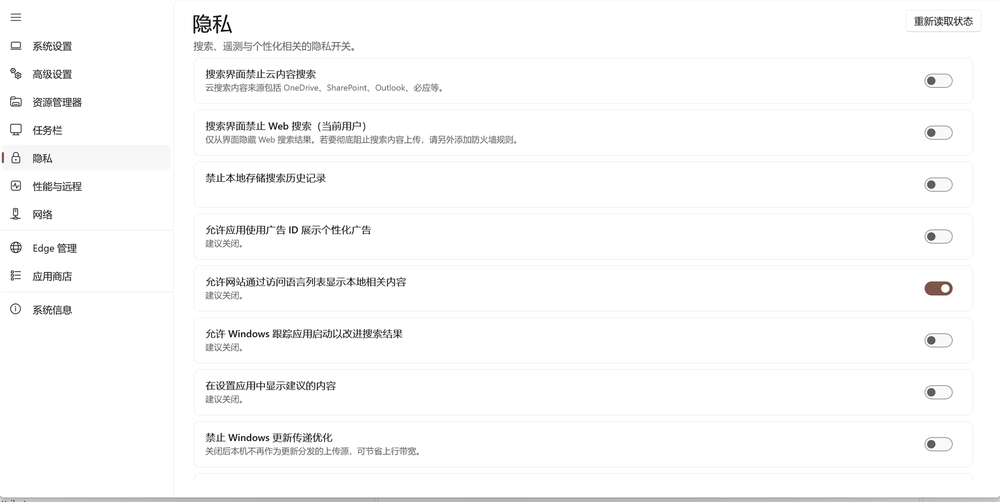
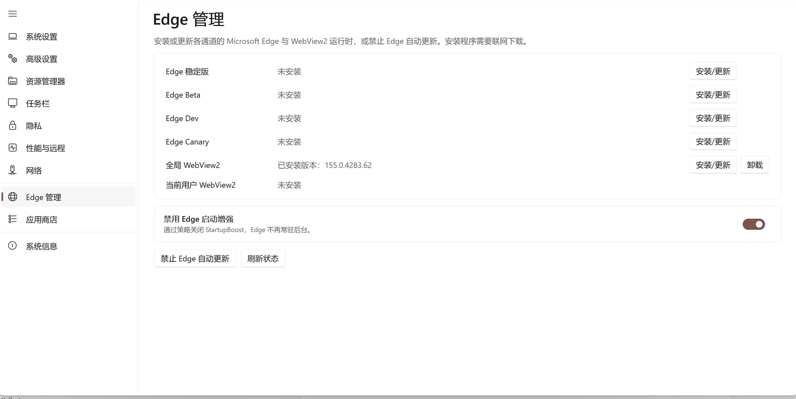

# Windows11 轻松设置

用于快速设置 / 优化 Windows 10 / 11 的图形化助手工具。
采用 .NET 10 + WinUI 3（Windows App SDK）与 MVVM 架构。

## 功能截图

<p align="center">
    
    
</p>

<p align="center">
    
    
</p>

> 开发与架构说明见 [docs/ARCHITECTURE.md](docs/ARCHITECTURE.md)。


## 技术栈

| 项 | 选择 |
|---|---|
| 运行时 | .NET 10（`net10.0-windows10.0.19041.0`） |
| UI 框架 | WinUI 3 / Windows App SDK 2.4.0 |
| 架构模式 | MVVM（CommunityToolkit.Mvvm 8.4.2，使用 `partial` 属性源生成） |
| 依赖注入 | Microsoft.Extensions.DependencyInjection |
| 打包方式 | 非打包（unpackaged）+ 自包含，双击即可运行 |
| 权限 | 清单声明 `requireAdministrator`，启动即提权 |

## 项目结构

```
Win11 Tools New/
├─ Win11EasyConfig.slnx
├─ Directory.Build.props              # 共享属性（语言版本、可空、版本号等）
├─ global.json                        # .NET 10：dotnet test 选用 Microsoft.Testing.Platform 运行器
├─ .github/workflows/release.yml      # 一键发布（Actions → 发布新版本）
├─ src/
│  ├─ Win11EasyConfig.Core/           # 纯逻辑层，不引用任何 UI
│  │  ├─ Abstractions/                # IRegistryService / ICommandRunner / IWindowsServiceManager
│  │  ├─ Services/                    # 注册表、命令执行、服务管理、系统信息、Shell
│  │  ├─ Models/                      # TweakState / TweakCategory / EffectScope
│  │  ├─ Tweaks/                      # 声明式调整项引擎
│  │  │  ├─ ITweak.cs                 # 统一接口：读状态 + 应用状态
│  │  │  ├─ RegistryTweak.cs          # 由「探测函数 + 开/关写入集」描述的注册表项
│  │  │  ├─ ServiceTweak.cs           # Windows 服务开关
│  │  │  ├─ CommandTweak.cs           # 由命令行输出决定状态的项
│  │  │  └─ TweakFactory.cs           # 常见模式的简写工厂
│  │  ├─ Settings/                    # 下拉 / 数值 / 动作三类设置的抽象
│  │  ├─ Features/                    # Edge / 应用商店 / 硬件信息
│  │  └─ Catalog/                     # 全部调整项的「数据」定义（新增设置只改这里）
│  │     ├─ SystemTweaks.cs           # 系统设置
│  │     ├─ AdvancedTweaks.cs         # 高级设置（安全缓解、UAC、DEP…）
│  │     ├─ ExplorerTweaks.cs         # 资源管理器 + 任务栏（含「自动隐藏任务栏」）
│  │     ├─ ExplorerExtras.cs         # 资源管理器下拉选项 + 功能按钮
│  │     ├─ PrivacyTweaks.cs          # 隐私
│  │     ├─ PrivacyExtras.cs          # 隐私相关功能按钮（搜索防火墙规则等）
│  │     ├─ PerformanceTweaks.cs      # 休眠、内存管理、远程访问
│  │     └─ TweakCatalog.cs           # 汇总入口
│  └─ Win11EasyConfig.App/            # WinUI 3 应用
│     ├─ AppHost.cs                   # 依赖注入组合根
│     ├─ App.xaml(.cs)
│     ├─ MainWindow.xaml(.cs)         # NavigationView 外壳
│     ├─ app.manifest                 # requireAdministrator + PerMonitorV2 DPI
│     ├─ ViewModels/                  # CategoryPageViewModel / EdgeViewModel /
│     │                               # AppsViewModel / SystemInfoViewModel + Settings/* 四类卡片 VM
│     └─ Views/                       # CategoryPage（通用分类页）/ EdgePage / AppsPage / SystemInfoPage
└─ tests/
   └─ Win11EasyConfig.Core.Tests/     # Core 单元测试（xunit v3，34 个用例，全部基于假实现）
```

## 架构要点

**1. 调整项即数据（声明式目录）**

每个调整项都抽象为 `ITweak`，并在 `Catalog/` 中以数据方式声明，逻辑与界面完全解耦，例如：

```csharp
factory.Policy(
    "system.ceip", "微软客户体验改善计划（CEIP）", TweakCategory.System,
    SqmClientKey, "CEIPEnable", offValue: 0,
    description: "普通用户建议关闭，可减少后台遥测数据上传。");
```

新增一个调整项 = 在目录里加一行数据，**无需改动任何界面代码**。

**2. 分类页是数据驱动的，专用页各管一摊**

`CategoryPage` 是唯一的**调整项**页面：它按 `TweakCategory` 从目录取数据，渲染开关 / 下拉 / 数值 /
动作分组四类卡片，因此新增分类不会带来新的 XAML 文件。商店、Edge、系统信息这类有专属交互的功能
则各有自己的页面（`AppsPage` / `EdgePage` / `SystemInfoPage`）。

导航结构（`MainWindow.xaml`，共 10 项）：系统设置 / 高级设置 / 资源管理器 / 任务栏 / 隐私 /
性能与远程 / 网络 → Edge 管理 / 应用商店 → 系统信息。

**3. 状态回读**

每次切换开关后都会重新读取真实状态再回填界面。若写入被系统策略
（如 UCPD 驱动）静默拦截，开关会自动弹回并显示错误，不会出现「界面显示已改、实际没改」。

**4. Core 不依赖 UI，且有单元测试兜底**

`Win11EasyConfig.Core` 可独立引用与测试；`tests/Win11EasyConfig.Core.Tests` 基于假实现
（假注册表 / 假命令执行器 / 假服务管理器）覆盖：目录完整性（57 开关 + 6 下拉 + 2 数值 +
25 动作 = 90 项、联动引用、只读契约）、「自动隐藏任务栏」的状态读取与位翻转、
注册表引擎的探测与写入语义、商店应用清单（61 项）。

## 生成与运行

> 两个项目均只支持 **x64**（见 `Directory.Build.props`）。解决方案 `Win11EasyConfig.slnx`
> 已显式声明 `x64` 平台以及每个项目的 `<Platform Project="x64" />` 映射——若缺少这些映射，
> Visual Studio 会尝试按默认的 “Any CPU” 去匹配，从而报「project configuration does not exist」。

```powershell
# 生成整个解决方案
dotnet build Win11EasyConfig.slnx -c Release

# 运行 Core 单元测试（xunit v3 / Microsoft.Testing.Platform，34 个用例）
dotnet test --project tests/Win11EasyConfig.Core.Tests -c Release

# 发布为可直接分发的自包含目录
dotnet publish src/Win11EasyConfig.App/Win11EasyConfig.App.csproj -c Release
```

| 文件 | 说明 | 体积 |
| --- | --- | --- |
| `Win11EasyConfig-<版本>-win-x64-standalone.zip` | **独立版**：内置 .NET 与 Windows App SDK 运行时，无需任何环境即可运行 | ~70 MB |
| `Win11EasyConfig-<版本>-win-x64-runtime-dependent.zip` | **精简版**：不含运行时，需目标机器安装 [.NET 10 桌面运行时](https://dotnet.microsoft.com/download/dotnet/10.0) 与 [Windows App SDK 运行时](https://learn.microsoft.com/windows/apps/windows-app-sdk/downloads) | ~10 MB |

### 发布新版本

在 GitHub 仓库页面进入 **Actions → 发布新版本 → Run workflow**，填写版本号（如 `1.3.0`，可勾选
「预发布」）即可；推送形如 `v1.3.0` 的标签也会触发。工作流在 `windows-latest` 上执行上述两条发布
命令并打包为两个 zip，随后自动创建 GitHub Release，无需本地操作。

## 注意事项

- 本工具会修改系统设置，请在更改前阅读每项的说明文字。
- 需要管理员权限；未提权时标题栏会给出提示，且部分状态（如内存管理相关项）无法读取。
- 部分设置可能被微软 UCPD 驱动拦截，此时开关会回弹并提示失败。
